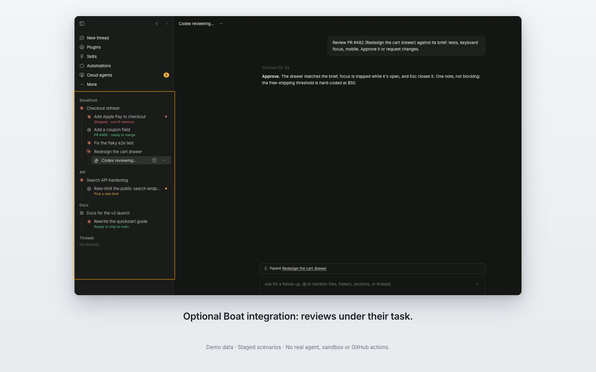

# Workbench sidebar for bb

Keep work easy to follow in [bb](https://getbb.app): provider activity,
nested chats and reviews, quiet unread signals, and parent rows that stay
visible while you scroll.

Workbench preserves bb's thread-list features: projects and sections,
drafts, search, keyboard navigation, rename, archive and Undo, context menus,
shortcuts and split drag. It works on desktop and phone.

[](docs/demos/workbench-v1.mp4)

[Watch the Workbench demo](docs/demos/workbench-v1.mp4): nested reviews
and pinning, paired with Boat. Captions and focus outlines guide the
recording; the UI uses staged demo data.

## What it adds

- Provider marks with a ring while work is running.
- One title-line signal for attention, unread work or a draft.
- Quiet **new** text for chats created for you, cleared when you open them
  or their source chat's task list.
- Nested tasks and italic review rows, with continuous tree lines.
- Groups with seven or more open children collapse on first use, then
  remember your choice. Updates wait while your pointer or keyboard focus
  is in the list.
- Pinned section and parent headers, pushed away by the next group.
- With Boat, queued requests stay visible before a task chat exists. Start
  now opens its paid-start confirmation; Cancel affects only that request.

## Works well with Boat Cloud Agents

[Boat Cloud Agents](https://github.com/scheinriese/bb-plugin-boat) starts and
coordinates cloud work. Workbench makes its tasks, independent reviews,
ready changes and reset waits easier to follow in the sidebar.

The pairing is optional. Workbench uses ordinary bb data without Boat;
Boat works with bb's regular sidebar. Workbench reads Boat's versioned
sidebar contract and degrades quietly if it is unavailable.

## Try the local build

```sh
bb plugin install /path/to/bb-plugin-workbench-sidebar
```

The sidebar slot activates when the plugin is enabled. Restore bb's regular
list with:

```sh
bb plugin disable workbench-sidebar
```

This checkout is prepared for review; publication is a separate step.

## Compatibility and development

This version tracks bb 0.48.1 and Plugin SDK 0.6.104. It is a complete fork
of bb's MIT-licensed thread-list plugin; upstream attribution is retained.
See [upstream inventory](docs/upstream.md),
[Boat contract](docs/boat-sidebar-contract.md) and
[host boundaries](docs/api-limits.md).

```sh
npm ci
npm run typecheck
npm test
npm run build
```

The preference CLI is `bb workbench-sidebar prefs …`. No account, inference
service or cloud sandbox is required by Workbench itself.
